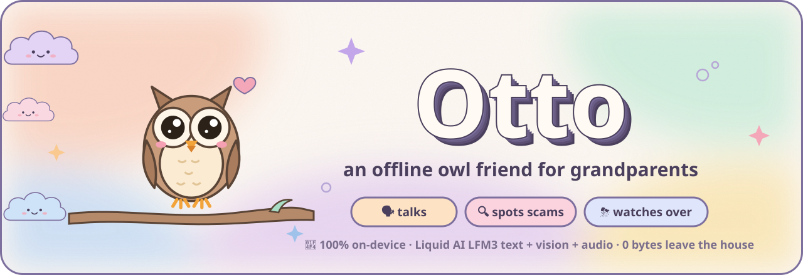
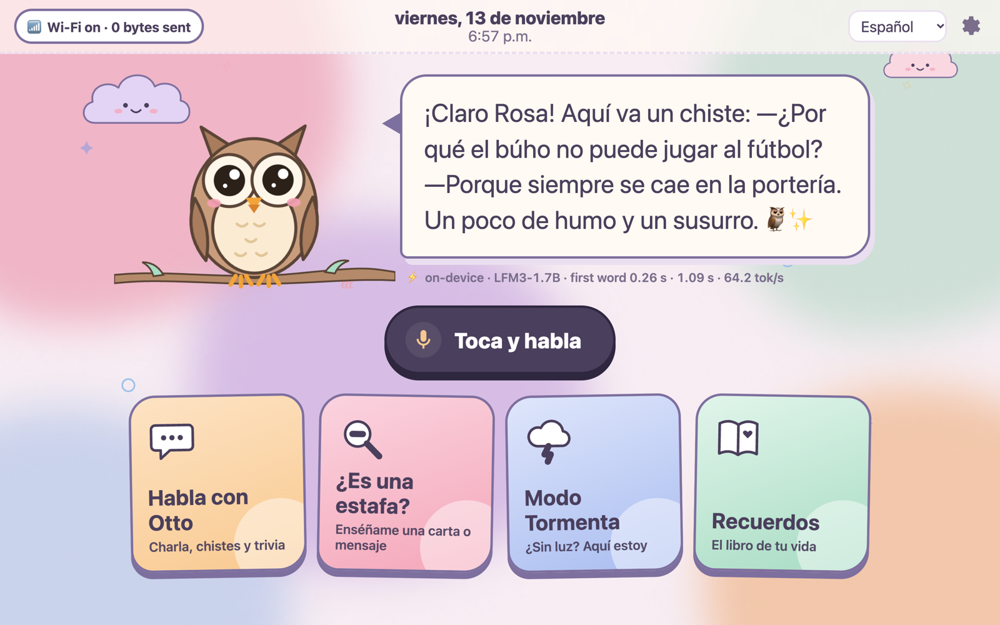
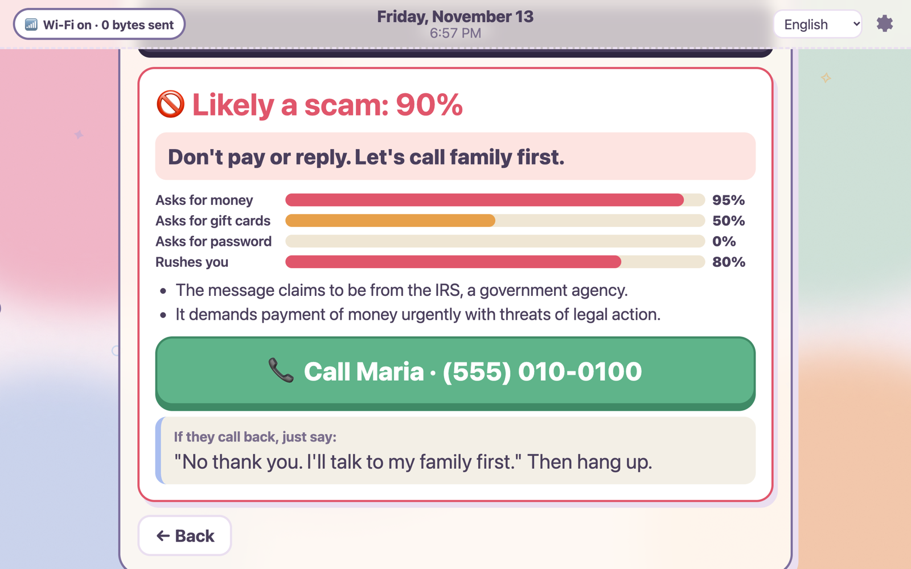
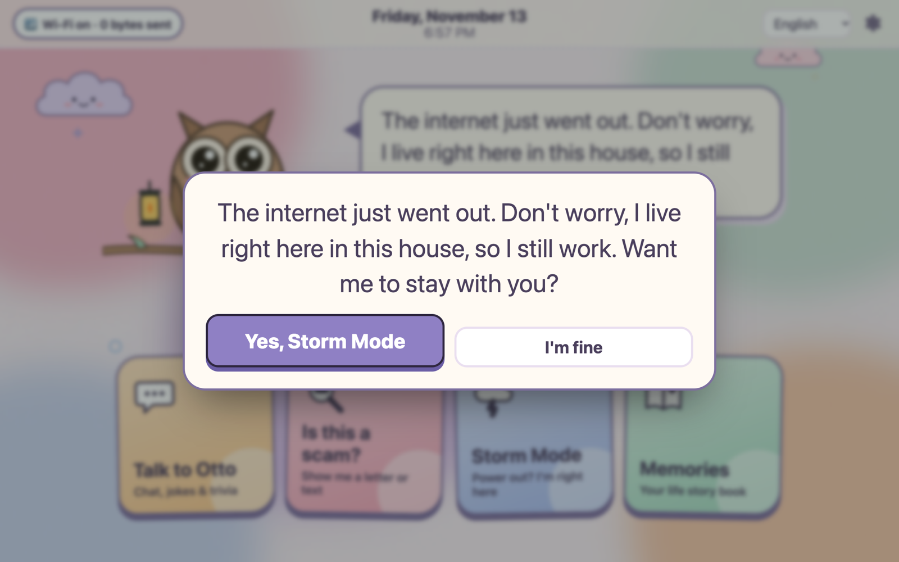
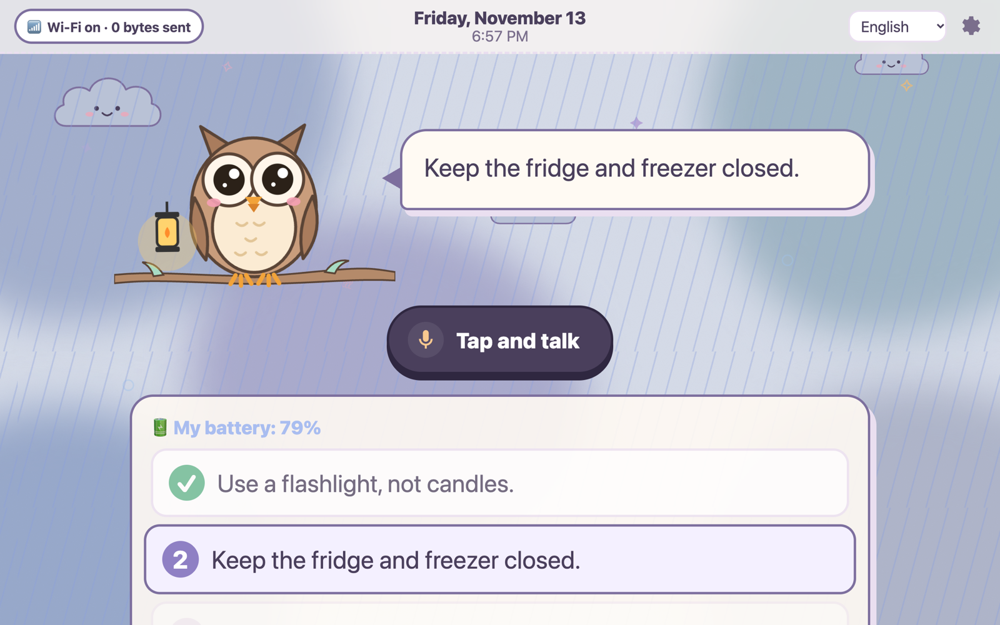
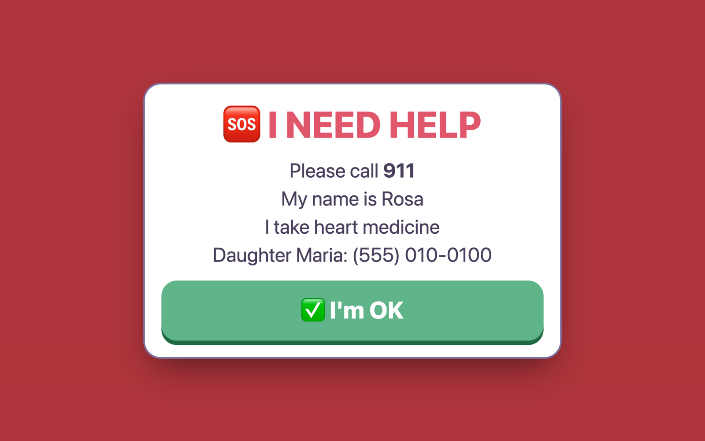
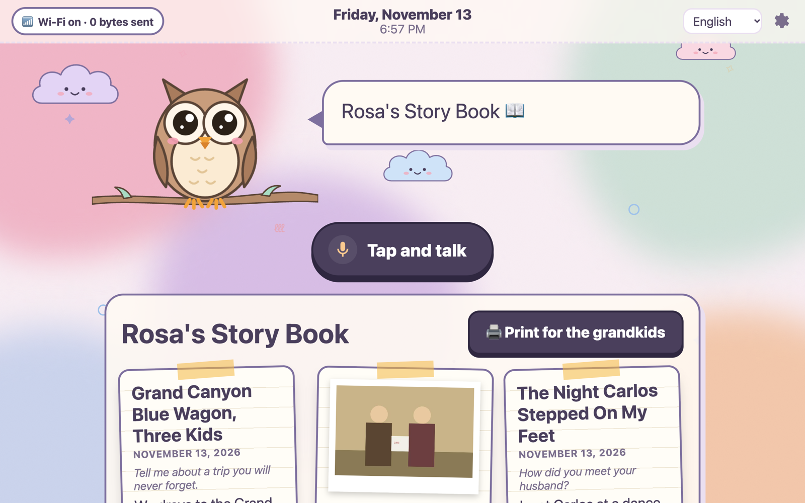
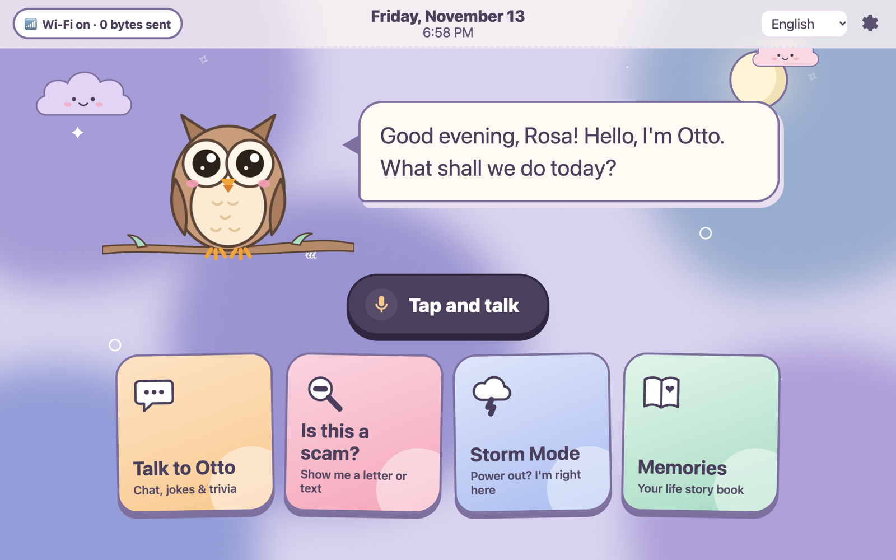
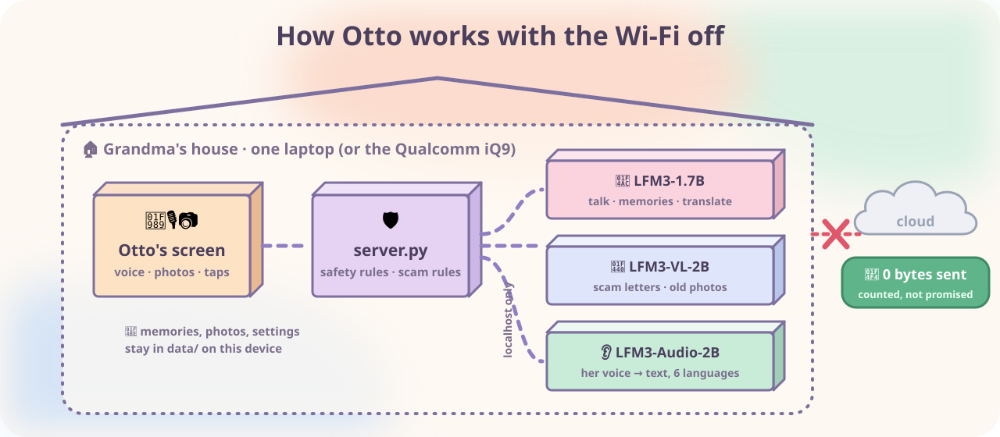

<p align="center">
  
</p>

<p align="center">
  
  
  
  
</p>

<p align="center"><b>Grandma talks to Otto in her own language. He keeps her company, catches scams before she pays, and checks on her when the power and internet go down.<br>Everything runs on the device. Nothing leaves the house, and the screen proves it.</b></p>

<p align="center"><i>Built solo at the Liquid AI × Qualcomm On-Device AI Hackathon.</i></p>

---

## 🌸 Meet Otto

<table>
<tr>
<td width="50%"><br><b>🎙️ Talk out loud, in her language.</b> She taps and speaks; LFM3-Audio hears her on-device. Replies stream in (first word in <b>0.26 s</b>) and Otto reads them aloud.</td>
<td width="50%"><br><b>🔍 "Is this a scam?"</b> She photographs a letter. Detective Otto gives a verdict with confidence bars and plain reasons, then a giant <b>📞 Call Maria</b> button.</td>
</tr>
<tr>
<td><br><b>📴 Otto notices on his own.</b> When the Wi-Fi drops (or the charger is pulled in a power cut), he speaks up: "I live right here in this house, so I still work."</td>
<td><br><b>⛈️ Storm Mode.</b> Rain falls, the clouds look worried, and Otto lifts his lantern. He shows his battery level, reads out a calm checklist and asks "Are you OK?" every so often.</td>
</tr>
<tr>
<td><br><b>🆘 If she doesn't answer</b> within 15 s: loud beeps and a flashing card with her name, medical note and family phone, for whoever walks in.</td>
<td><br><b>📖 Her Story Book.</b> Otto asks about her life, or looks at an old photo (LFM3-VL) and asks who's in it. Each answer becomes a taped-in scrapbook page, ready to <b>print for the grandkids</b>.</td>
</tr>
</table>

<p align="center"><br><i>The sky follows the real time of day. At night the stars come out and the cloud friends fall asleep.</i></p>

## ✨ Little things that make it feel alive

| | |
|---|---|
| 💗 **Pet Otto** | Tap him and he squishes, giggles a line in her language, and hearts float up |
| 👀 **He watches you** | His eyes follow your finger or mouse around the screen |
| ☁️ **Cloud friends** | Little watercolor clouds drift by. They smile by day, sleep (zzz) at night and look worried in a storm |
| 🎭 **Moods** | Detective hat for scams, a lantern in storms, worried brows, happy eyes, a head tilt when he's listening |
| ✦ **Sparkles** | Every button tap pops a little sparkle burst; saving a memory rains hearts and stars |
| 🕰️ **Orientation** | A big day, date and time, and a greeting that matches the time ("Good evening, Rosa!") |
| 🫧 **Gentle by design** | 24px+ text, giant buttons, slow, warm speech. With `prefers-reduced-motion` on, everything stays still |

## 🏠 How it works with the Wi-Fi off

<p align="center"></p>

- The page is vanilla HTML/JS with **no CDNs, web fonts or remote assets**. Speech out uses local macOS voices. Browser speech recognition is deliberately not used because it needs the internet; LFM3-Audio handles it instead.
- `server.py` (FastAPI) talks **only** to three local `llama-server`s through `llm.py`.
- **"0 bytes sent" is counted, not promised.** An httpx hook counts any request from the server that isn't to localhost, and the browser checks every resource it loaded (Resource Timing). If anything ever left the device, the badge would turn red.

## 🧠 Models (all Liquid AI LFM3, all local)

| Job | Model | Quant |
|---|---|---|
| Talk (streamed), Memory Lane, titles, translating reasons | `LiquidAI/LFM3-1.7B-GGUF` | Q4_K_M |
| Scam Check (photo → strict JSON), Photo Memories | `LiquidAI/LFM3-VL-2B-GGUF` + mmproj | Q4_K_M / Q8_0 |
| Her voice → text, 6 languages | `LiquidAI/LFM3-Audio-2B-GGUF` + mmproj | Q4_K_M / Q8_0 |

Thinking is turned off per request (`chat_template_kwargs.enable_thinking=false`) so answers come straight back.

### ⚡ Real latency (Apple M4 MacBook, measured)

| Action | Time | Speed |
|---|---|---|
| Talk reply, first word (streamed) | ~0.3 s | ~60 tok/s |
| Talk reply, full | ~0.8–1.2 s | ~60 tok/s |
| Voice → text | ~0.5–1.0 s | ~61 tok/s |
| Memory Lane question | ~0.65 s | ~62 tok/s |
| Photo Memories question | ~1.5 s | ~60 tok/s |
| Scam Check, pasted text | ~2.4 s | ~61 tok/s |
| Scam Check, photo + reasons translated | ~4.8 s | ~61 tok/s |

The real numbers appear under every answer on screen ("⚡ on-device · LFM3-1.7B · first word 0.26 s · 64 tok/s").

## 🚀 Run it offline

```bash
brew install llama.cpp                      # needs build ≥ b12088 for LFM3 (tested: 1.0.0 / b12359)
python3 -m venv .venv && .venv/bin/pip install fastapi uvicorn httpx pydantic
hf download LiquidAI/LFM3-1.7B-GGUF LFM3-1.7B-Q4_K_M.gguf --local-dir models
hf download LiquidAI/LFM3-VL-2B-GGUF LFM3-VL-2B-Q4_K_M.gguf mmproj-LFM3-VL-2B-Q8_0.gguf --local-dir models
hf download LiquidAI/LFM3-Audio-2B-GGUF LFM3-Audio-2B-Q4_K_M.gguf mmproj-LFM3-Audio-2B-Q8_0.gguf --local-dir models
```

Then **turn Wi-Fi off** and run:

```bash
./run.sh          # starts the three llama-servers in the background, then the app
open http://localhost:8000
```

<details><summary><code>run.sh</code> runs these</summary>

```bash
llama-server -m models/LFM3-1.7B-Q4_K_M.gguf --port 8080 -c 4096 -ngl 99 --jinja
llama-server -m models/LFM3-VL-2B-Q4_K_M.gguf --mmproj models/mmproj-LFM3-VL-2B-Q8_0.gguf --port 8081 -c 4096 -ngl 99 --jinja
llama-server -m models/LFM3-Audio-2B-Q4_K_M.gguf --mmproj models/mmproj-LFM3-Audio-2B-Q8_0.gguf --port 8082 -c 4096 -ngl 99 --jinja --temp 0
BACKEND=mac uvicorn server:app --host 127.0.0.1 --port 8000
```
</details>

- **Backends** (`llm.py`): `BACKEND=mac` (local llama-server), `iq9` (set `IQ9_URL`), or `replay` (canned answers, a last-resort demo saver).
- **Demo links:** open any screen in a ready state with `?demo=talk`, `scam`, `storm`, `offline`, `alarm`, `memories` or `night`.
- **Demo letters** for Scam Check are in `demo/`. All phone numbers are fake 555 numbers.

## 🔍 How Scam Check stays honest

- The JSON schema is enforced by llama.cpp (`response_format`) and validated with pydantic, with one retry on bad JSON.
- The schema puts the **evidence first** (`asks_reader_to`, `reasons`, per-flag probabilities) and the overall `scam_prob` **last**, so the score follows from the evidence.
- `calibrate()` keeps the score consistent with what the model itself found. A friendly grandkid note scored 95% before this; now it scores 1%.
- Rules in code: any money, gift card or password request means **"Don't pay or reply. Let's call family first."** A `scam_prob` between 0.4 and 0.75 means **"I'm not sure. Let's ask Maria before doing anything."**

## 🛡️ Safety (enforced in code, not just in the prompt)

- **No medicine doses or diagnoses.** Medical questions are caught before the model runs: "Please call your doctor, or 911 in an emergency." Replies are also checked for dosages while they stream.
- **Never helps send money, buy gift cards or share passwords.** Those requests get a fixed refusal plus "let's call Maria first".
- **Shows its confidence** and asks family when unsure.
- **Private:** memories, memory photos (`data/photos/`) and settings stay in `data/` on this device. Scam photos are never stored.
- **Not a replacement for 911**, as Otto says on every screen.

## 🎬 60-second demo

1. "Meet Otto." Tap the mic and say *"Otto, cuéntame un chiste"*. Words stream in and Otto speaks.
2. **Turn Wi-Fi off.** Otto notices on his own, and the badge turns green: **📴 Offline ✓ · 0 bytes sent**.
3. Show `demo/irs_scam.png` → detective Otto → "Likely a scam" → **📞 Call Maria**.
4. **Unplug the charger.** Otto: "Looks like the power went out." Storm Mode → don't tap → alarm + **I NEED HELP**.
5. Show an old photo → Otto asks about it → it lands in the Story Book. "Text, vision and audio, all on-device with Liquid LFM3. Zero bytes left the house."

## 🗺️ Roadmap

- **A.** Run on the Qualcomm **iQ9** (Nexa SDK on the NPU, or llama.cpp on the CPU) via `BACKEND=iq9`, with iQ9 latency on screen.
- **B.** **d1-2B** for Scam Check (calibrated probabilities in one pass).
- **C.** LFM3-Audio **voice out** too, so Otto has his own voice. Voice in is done.
- **D.** Family digest: a weekly on-device summary of her memories and check-ins that she chooses to share.
- **E.** Battery and quiet-hours settings for Storm Mode check-ins (every 30 min in real life; turn off Demo mode in Settings).
